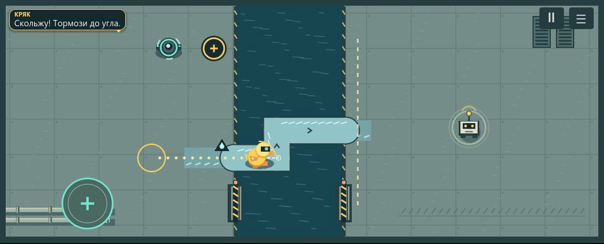

# Quack

Аркада-головоломка о робоутке Кряке и дроне Шайбе. Запиши маршрут Кряка, затем помоги ему пройти его, управляя Шайбой одновременно с повтором.

[Смотреть демку](media/quack-demo.mp4) · [Отчёт о прототипе](docs/report.pdf) · [Скачать Windows-сборку](https://github.com/DXaten/Quack/releases/latest)

## Запуск

Скачай Quack.exe из релиза и запусти на Windows x64. Для запуска исходников импортируй project.godot в Godot 4.7.2 Standard и нажми F5. Используется рендерер Compatibility.

## Управление

| Клавиши | Действие |
| --- | --- |
| WASD или стрелки | Кряк во время записи и буксировки, Шайба во время повтора |
| Пробел | Начать запись, затем запустить повтор |
| Пробел на уровне 02 во время записи | Прыжок |
| E рядом с Маячком | Зацепить или отпустить трос |
| R | Записать маршрут заново |
| Esc | Пауза |
| M | Меню |
| Tab в начале обучения | Повторить пример |

## Кампания

00 обучает записи и совместному действию. На 01 нужно доставить Маячка домой, 02 требует трёх прыжков, 03 даёт Шайбе дальний пульт, 04 проверяет торможение на скользком повороте, 05 сочетает скольжение, створки и водяную струю. Каждый следующий уровень открывается после победы на предыдущем. Обратный мост открывается после сцепки с Маячком.

## Создание прототипа

Концепт и правила уточнялись по игровым попыткам автора. Codex помог написать GDScript, нарисовать станцию средствами Godot, добавить обучение и исправить непонятные механики. После обратной связи обучение вынесено в уровень 00, сокращены подсказки, скользкий маршрут стал единственным путём четвёртого уровня.

Видео записано в Movie Maker Godot на текущей сборке. В съёмочной копии ввод воспроизведён программно через игровые действия. Монтаж выполнен в Remotion, индикаторы клавиш синхронизированы с вводом. В ролике есть запись, неудачная попытка, повтор, буксировка и победа. Съёмочная копия использует отдельное сохранение.

Все шесть уровней проверены последовательными прохождениями. Проверены поражение, замки меню, сохранение побед после перезапуска, скользкий поворот и створки. Следующий этап — наблюдать первые попытки новых игроков и по ним настроить сложность.

## Файлы

Сцены находятся в корне проекта. scripts/station.gd содержит запись, повтор и буксировку. scripts/expedition.gd задаёт препятствия миссий. scripts/campaign.gd хранит прогресс, scripts/menu.gd строит меню, scripts/dialogue.gd показывает реплики. Рисование вынесено в board.gd и expedition_board.gd. Код снабжён русскими комментариями.

Прототип создан в рамках учебного задания. Иллюстрации и короткие звуковые сигналы создаются средствами движка.
